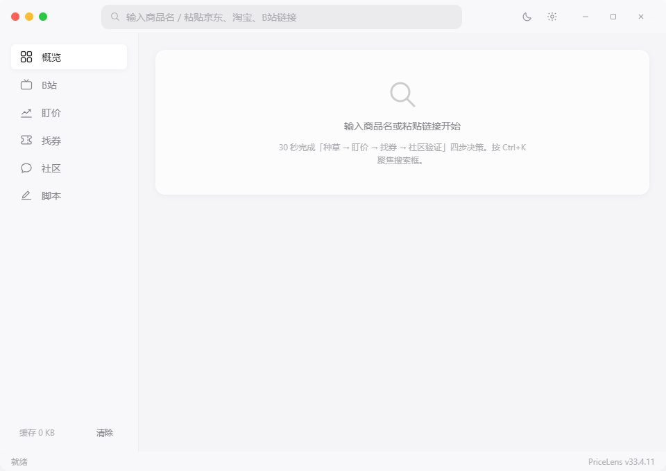
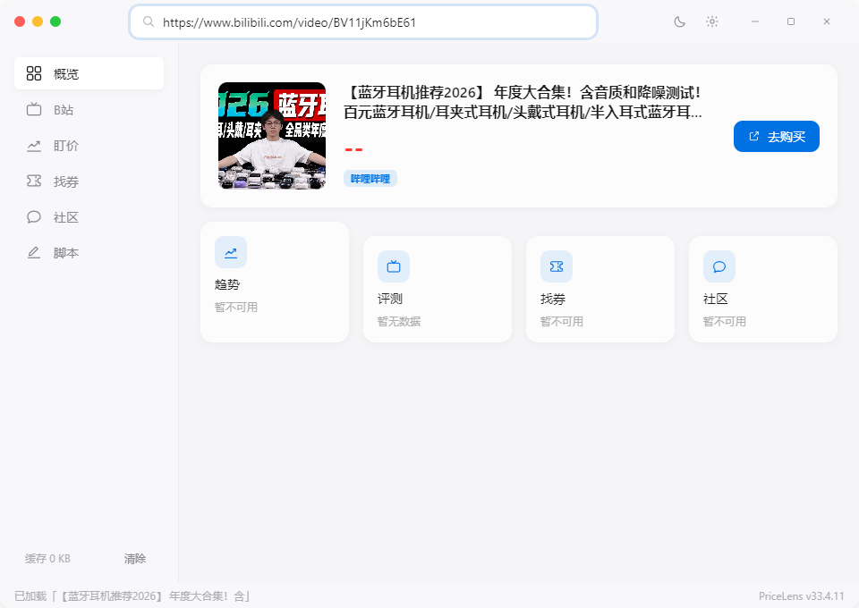
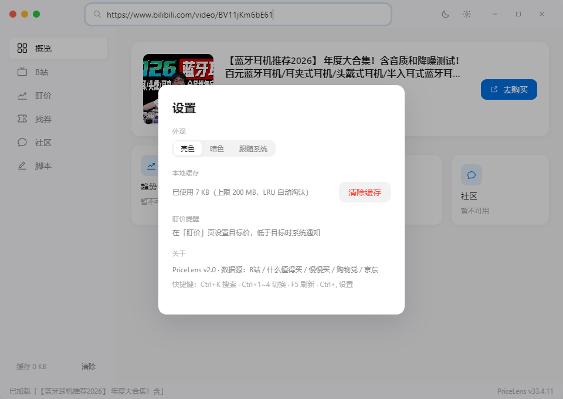
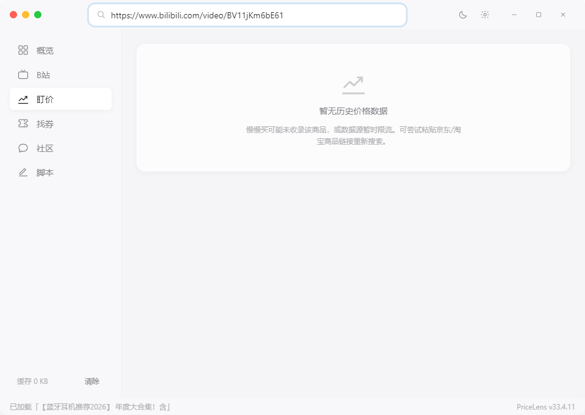
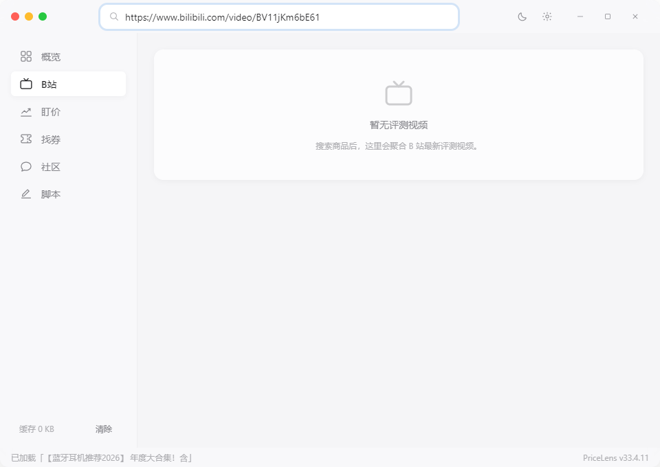
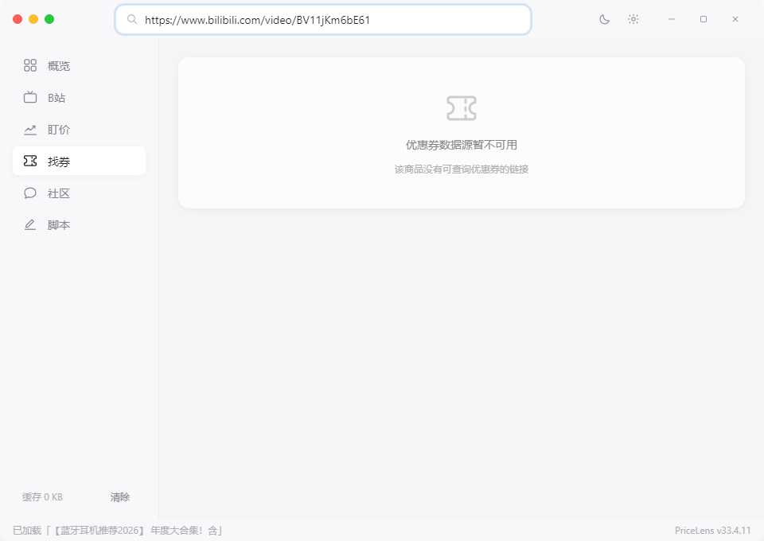
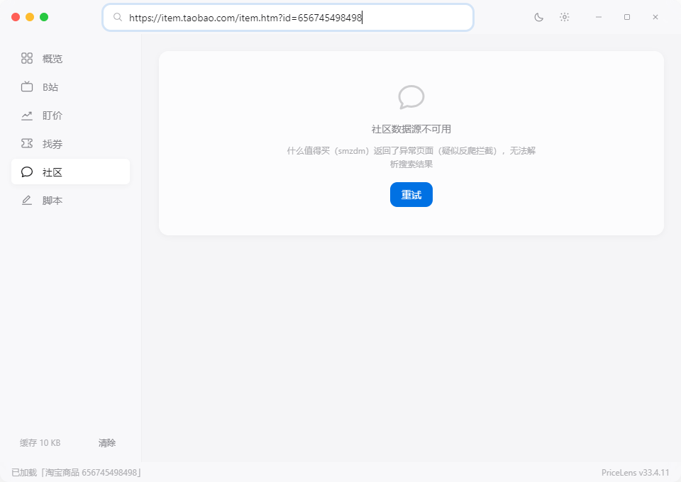

# PriceLens v2.4

> 极简主义全网比价决策工具 —— 30 秒完成「种草 → 盯价 → 找券 → 社区验证」四步购物决策闭环。
> v2.4 新增：**同款多平台对比**、**盯价提醒历史**、**盯价目标备份/恢复**。
> v2.3：多商品盯价（上限 20 个）、历史分位购买建议、剪贴板商品链接识别、数据源健康状态。
> v2.2：识货同款兜底源、B 站商单/夸大宣传标记（含否定语境豁免）。

  

## 界面预览

| 主界面 | 搜索概览 | 设置 |
|--------|----------|------|
|  |  |  |

| 盯价 | B 站评测 | 找券 | 社区 |
|------|----------|------|------|
|  |  |  |  |

> 截图见仓库 `assets/screenshots/`，与根目录 [README](../README.md) 界面预览章节同源。
> 截图为 v2.1 基线；v2.2/v2.3 新增的「识货同款」、风险标签、多盯价与购买建议见下方功能说明
> （本次未重拍上游实况截图，避免拿合成数据冒充实机）。

## 功能一览

| 模块 | 数据源 | 说明 |
|---|---|---|
| 🌱 种草 | B 站（WBI 签名） | 评测视频聚合，自动标注 ⚠️避坑 / 👍推荐；**商单 / 夸大宣传命中视频加标签并沉底**，只标记不删除 |
| 📈 盯价 | 慢慢买 / 星罗 / 自建曲线 | 手写 SVG 历史价格曲线，历史低价/先涨后降检测；**多商品盯价（上限 20 个）**，逐个暂停/恢复/删除，30 分钟后台轮询、托盘常驻、重启自动恢复 |
| 🧠 建议 | 历史采样 | 历史分位购买建议（可入手 / 价格中等 / 再等等）；少于 8 个采样点不硬下结论 |
| 🛍️ 多平台 | 值得买爆料 | 按平台聚合同关键词爆料，取各平台最低价并显示与当前价的差额；不保证同规格 |
| 🗂️ 备份 | 本机 JSON | 导出/导入盯价目标（不含 Cookie/apikey/运行态），最多 20 个，导入按 URL 合并 |
| 🎫 找券 | 购物党 | 隐藏优惠券 + 到手价 countUp 滚动，一键复制券码 |
| 💬 社区 | 什么值得买 + 识货 | 最新爆料、值/不值比例条、热评关键词高亮、近 7 天更低价横幅；**识货同款兜底**（国补/品牌/销量标签） |
| 📋 剪贴板 | 本机 | 窗口获得焦点时识别剪贴板里的京东/淘宝/B 站商品链接，提示一键去比价；只在本机读取 |
| 🛒 商品 | 京东 p.3.cn + 识货 | 支持直接粘贴京东/淘宝/B 站链接搜索；值得买无候选时用识货商品头兜底 |
| 📜 脚本 | 本机 PowerShell | 预置 3 个只读安全脚本 + 自定义脚本增删改查，输出实时展示，120s 超时保护 |

本地 JSON 缓存（LRU 200MB / TTL / stale-while-revalidate），**断网重启仍可查看上次数据**。

> **识货接口说明（2026-10 实况）**：`m.shihuo.cn` 搜索接口对匿名请求会返回字面量 `null`（站点侧限制），
> 桌面端与 Android 一样按「够着了但没数据」处理——**不伪造结果、不回退首页热榜**；此时社区继续展示
> 什么值得买数据，识货卡片不出现。接口恢复后无需更新应用即可生效。

## 环境要求

- Node.js ≥ 18
- Windows 10/11（打包目标）；开发调试在 macOS/Linux 亦可运行

## 快速开始

```bash
# 1. 安装依赖（会自动执行 postinstall 生成 build/icon.ico）
npm install

# 2. 启动应用
npm start

# 3. 解析器/规则单测（与 Android 同夹具，无网络）
npm test

# ── 可选：带热重载的开发模式 ──
npm run dev:web     # 终端 1：Vite 静态服务 (localhost:5173)
npm run dev         # 终端 2：Electron 加载 DevServer
```

### 可选依赖

购物党趋势页是 JS 渲染页面，`undici` 抓不到时自动降级 Playwright：

```bash
npm i -D playwright
npx playwright install chromium
```

未安装时该源给出可操作的降级提示，不影响其他模块。

## 打包分发

```bash
npm run build        # NSIS 安装器 + 便携 zip，输出到 dist/
```

产物（Electron 运行时体积较大，实测约 110 MB 安装器 / 150 MB 便携包）：

- `dist/PriceLens-x.x.x-x64.exe` — NSIS 安装器（可自定义目录，卸载时询问是否清缓存）
- `dist/PriceLens-x.x.x-x64.zip` — 便携版，解压即用

## 快捷键

| 快捷键 | 功能 |
|---|---|
| `Ctrl + K` | 聚焦搜索框 |
| `Ctrl + 1~4` | 切换 趋势 / 评测 / 优惠券 / 评论 |
| `Esc` | 关闭弹窗 / 清空搜索 |
| `Ctrl + ,` | 打开设置 |
| `F5` | 强制刷新当前数据（跳过缓存） |

## 数据与缓存目录

```
%APPDATA%/pricelens/
├── cache/            # JSON 缓存（products/history/bilibili/smzdm/coupons/misc；自建曲线走 history-local）
│   └── _index.json   # 索引：key → { file, ts, ttl }
├── settings.json     # 主题 / 多盯价目标 / 凭证（重启自动恢复轮询）
├── scripts.json      # 自定义脚本（名称 + 内容）
└── logs/crawl.log    # 爬虫日志
```

## 同款多平台与备份（v2.4）

- **同款多平台对比**：概览把同关键词爆料按平台聚合（京东/淘宝/拼多多/唯品会/苏宁/抖音等），
  每个平台取最低价并显示与当前价的差额；明确标注「不保证同规格」，避免把不同配置当成同款。
- **盯价提醒历史**：每个盯价目标记录上次提醒时间、提醒价与累计次数；列表里直接展示
  「上次提醒 1 小时前 @ ¥1899」，到价状态不再只有一句「已到价」。
- **盯价目标备份/恢复**：设置页可导出/导入 JSON，最多 20 个目标；备份只含关键词、链接、
  目标价、暂停状态，**不含 Cookie、星罗 apikey 与 current/lowest/notified 等运行态**。
  导入按 URL 合并：同 URL 以备份为准并重置提醒闩锁，新目标追加，超出上限的跳过并如实提示。

## 多商品盯价与购买建议（v2.3）

- **多商品盯价**：在商品历史价页把目标价加入盯价列表，最多同时盯 20 个商品；每个目标可暂停/恢复/删除，后台每 30 分钟逐项检查，到价只提醒一次，价格回升到目标价 102% 以上后重新武装；每次提醒记录时间/价格/累计次数。盯价页始终展示目标列表（即使当前商品没有曲线）。
- **历史分位购买建议**：按当前价在历史采样中的分位给出「可以考虑入手 / 价格中等 / 建议再等等」；样本少于 8 个点只显示「样本不足」，不硬下结论。判断口径与历史统计同源。
- **剪贴板识别**：复制京东/淘宝/B 站商品链接后切回窗口，顶部出现「去比价」提示；忽略后同一商品不再打扰。链接只在本机解析，不上传。
- **数据源健康**：概览展示历史价/B站/找券/值得买/识货各自的本轮状态（正常/无结果/不可用/加载中），源失败不再混成一句「暂无数据」。

> v2.2 的识货 m 站接口在 2026-10 实测对匿名请求常返回 `null`；应用按空结果如实降级，
> 接口恢复后无需更新应用即可生效。

## 识货兜底与内容风险（v2.2）

- **识货同款**：值得买没有可用商品候选时，搜索以识货结构化结果补商品头；社区页在爆料之前展示「识货同款」卡片（标题 / 价格 / 品牌 / 销量 / 国补）。识货没有稳定商品详情页，条目统一跳识货搜索页；因此不会拿搜索页冒充历史价/盯价的商品链接。
- **商单/夸大标记**：沿用 Android v2.4.4 的商单词库、夸大话术词库与 B 站联合投稿标记，命中视频挂「疑似商单 / 夸大宣传」标签并沉底；**桌面端额外增加否定语境豁免**——「不恰饭」「无广告」「不是商单」「并非天花板」不会被误标（Android 仍为裸子串匹配，待同步）。

## 盯价后台与托盘（v2.1 起，v2.3 支持多目标）

- 在「盯价」页设置目标价后，主进程以 **30 分钟周期**逐项轮询当前价；低于目标价 → 系统通知 + 侧边栏红点，回升 2% 以上后自动重置可再次提醒。
- 多目标各自记录当前价、历史最低、上次检查与失败原因；单个源失败不会影响其它目标。
- 关闭窗口 → 最小化到托盘继续轮询；托盘右键：显示主窗口 / 立即检查盯价 / 退出；双击托盘图标还原窗口。
- 应用重启后自动恢复全部盯价目标（配置持久化于 settings.json）。

## 安全架构（红线清单）

- ✅ `nodeIntegration: false` + `contextIsolation: true` + `sandbox: true`
- ✅ 渲染进程仅通过 `preload.js` 的 `contextBridge` 白名单 API 通信
- ✅ 外部数据一律 `textContent` / DOM API 渲染，无 `innerHTML` 插入未消毒数据
- ✅ 禁止新窗口 / 导航劫持 / webview；拒绝全部权限申请
- ✅ 爬虫纪律：同域 ≤1 req/3s、并发域名 ≤3、超时 10s 重试 1 次、403 降级 5 分钟
- ✅ 主进程全部 `fs.promises` 异步 IO

安全自检：`npx electronegativity -c ./src`（应无 HIGH/CRITICAL）。

## 浏览器联动与致谢（摘要）

**浏览器联动（剪贴板桥）**：在浏览器商品页复制商品链接 → 切回 PriceLens，顶部会提示「去比价」；也可以直接粘贴到搜索框（原生支持京东 / 淘宝 / B 站链接直达）。链接只在本机解析，不上传。进阶玩法：在浏览器安装购物党官方油猴脚本秒查站内历史价格，再回到本应用完成盯价、找券与社区验证。

**致谢**：盯价模块数据来自慢慢买公开页面，找券模块数据来自购物党公开页面（解析规则由本项目自行分析公开页面编写，相关平台/插件未贡献代码）。完整致谢、推荐插件清单（含推广内容披露）与免责声明见根目录 [README · 致谢](../README.md#-致谢) 与 [README · 浏览器联动](../README.md#-浏览器联动剪贴板桥)。

## 项目结构

```
pricelens/
├── src/main/            # 主进程：窗口 / IPC / 爬虫 / 缓存
│   ├── crawlers/        # bilibili(wbi) / smzdm / manmanbuy / gwdang / jd / linkstars / shihuo
│   ├── cache/           # LRU + TTL 缓存管理；settings.json 含多盯价目标
│   └── utils/           # http-client / rate-limiter / logger / sanitizer / relevance / ranking / content-risk / price-advice / watch-state / platform-compare / backup
├── src/renderer/        # 渲染层：零框架原生 HTML/CSS/JS（ES modules）
│   ├── css/             # tokens / base / layout / components / animations
│   └── js/              # app / router / components / utils
├── build/               # icon.ico（脚本生成）+ installer.nsh
└── electron-builder.yml
```

## 免责声明

本项目仅供个人学习与比价研究。数据来自各平台公开页面/接口，请遵守各站点 ToS 与 robots 约定，控制请求频率（应用内置限流）。商业使用请接入官方 API（如京东联盟）。
